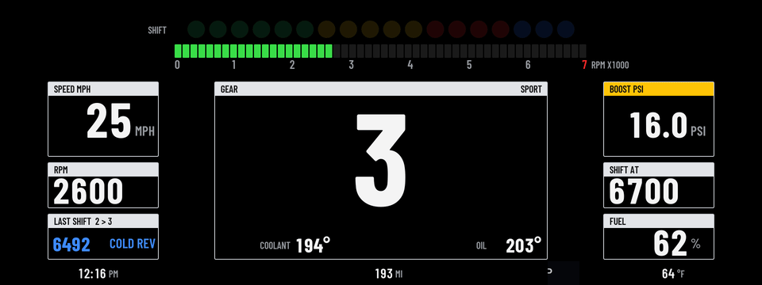
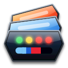
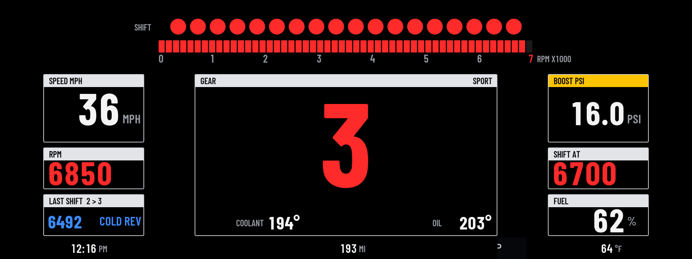
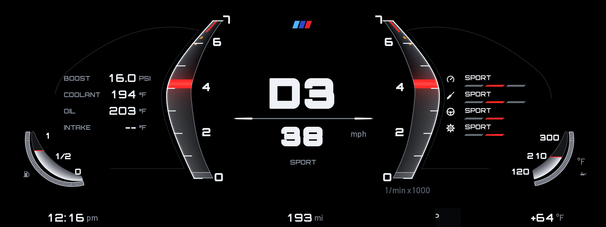
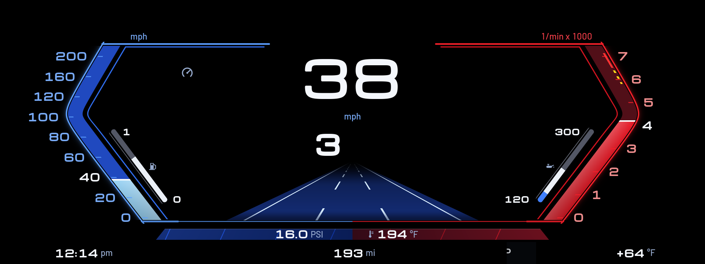
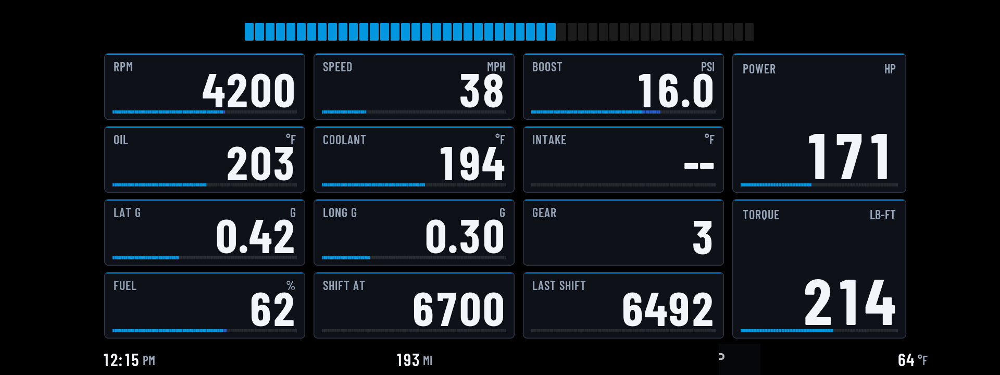

<h1 align="center">46Wen apps</h1>

Las apps que uso en mi BMW con iDrive 7 (MGU), todas en un solo origen para el MGU Store. Coche sin HUD: nada de lo que hay aquí dibuja en el head-up display.

## Apps

| App | Para qué sirve | De dónde viene | Licencia |
|---|---|---|---|
| **Cluster Themes** (`cluster_themes`) | Redibuja el cuadro de instrumentos con un tema (GT3, M, M view, Vector, Sport, Cruise...), también según el modo de conducción | [bimmer-lab/apps](https://github.com/bimmer-lab/apps) + cambios propios | MIT |
| **Fuel Link** (`fuel_link`) | Combustible y autonomía en el móvil por la tailnet; sin icono ni pantalla, funciona en segundo plano | propia | MIT |
| **Copiloto de voz** (`copiloto_voz`) | Su BMW le habla, por prioridad y nunca durante una llamada: bienvenida al arrancar, fin del viaje, combustible bajo, neumáticos, hielo, motor frío y caliente, mantenimiento, ventanillas y pausas, con la voz Elvira. [Cómo funciona](apps/copiloto_voz/README.md) | propia | MIT |
| **Redline** (`redline`) | Cuentarrevoluciones a pantalla completa con luces de cambio, marcha y puntuación de cambios. Sin la parte de HUD | [cauliflowermossgrape/idrive7-apps](https://github.com/cauliflowermossgrape/idrive7-apps) | MIT |
| **Drag Timer** (`draggy`) | 0-100, ¼ de milla, 100-200, mejores tiempos | cauliflowermossgrape/idrive7-apps | MIT |
| **Virtual Dyno** (`dyno`) | Curvas de potencia y par a partir de una aceleración a fondo | cauliflowermossgrape/idrive7-apps | MIT |
| **Ambient config** (`ambient_config`) | Cualquier color en la luz ambiente, un color por modo de conducción, animaciones | cauliflowermossgrape/idrive7-apps | MIT |
| **DPF Monitor** (`dpf_monitor`) | Filtro de partículas y regeneraciones (diésel), solo lectura | [NamelsMissing/mgu-apps](https://github.com/NamelsMissing/mgu-apps) | GPL-3.0 |
| **iDrive Monitor** (`jap_sysmon`) | CPU, memoria y swap de la unidad; avisa cuando va justa | [JustAnotherPU/mgu-apps](https://github.com/JustAnotherPU/mgu-apps) | MIT |
| **Maps on cluster** (`robertn_waze_cluster`) | El mapa de CarPlay (Waze, Apple o Google Maps) en el cuadro | [robertnisipeanu/idrive-apps](https://github.com/robertnisipeanu/idrive-apps) | GPL-3.0 |
| **RideTube** (`jap_ridetube`) | Cliente de YouTube; al conducir solo el audio | [JustAnotherPU/ridetube](https://github.com/JustAnotherPU/ridetube) | GPL-3.0 |

Componentes nativos que se instalan solos con las apps que los necesitan (`tools-prebuilt/`, los binarios publicados por sus autores, sin cambios): `cluster-render`, `waze-on-cluster`, `idrive7-renderd` (renderizador GPU), `mgu-inputgate` (mando del iDrive), `jap-ridetube-d` (servicio de RideTube) y `mgu-render-id7-touch` (opcional).

**Node.js 22 (`jap-node22`) no está aquí:** su binario pesa 137 MB y GitHub no admite archivos de más de 100 MB. RideTube lo necesita: añade también el origen `JustAnotherPU/mgu-apps` (canal *Releases*) en el Store y se instala desde allí.

## Instalar

1. En el Store: **Settings, Add source**, `46Wen/apps`, canal **branch** (o `branch:mgu-bundle` mientras pruebas esta rama).
2. Para RideTube, añade también `JustAnotherPU/mgu-apps` (Releases), por `jap-node22`.
3. Si tenías instaladas estas apps desde sus orígenes originales (bimmer-lab, cauliflowermossgrape, robertnisipeanu, JustAnotherPU, NamelsMissing), desinstálalas de allí o quita esos orígenes, para que cada app y cada componente venga de un solo sitio.
4. El reloj de la unidad va en UTC: en Cluster Themes pon **Settings, Time zone (clock)** a tu zona una vez.

El Store compila cada app en el coche desde este repositorio; el SDK de BMW no está en él (lo genera el coche).

## Estructura

- `apps/`, `kit/`, `shared/`: Cluster Themes y Fuel Link, con el kit de bimmer-lab.
- `vendor/<origen>/`: cada app traída con el kit de su propio repositorio, para que se compile igual que en el original. `vendor/README.md` dice de qué commit viene cada una y qué se ha cambiado.
- `tools-prebuilt/<id>/`: los componentes nativos, como carpetas de herramienta del Store (`component.json` y sus archivos).
- `mgu-repo.json`: la lista para el Store. Cada app de `vendor/` lleva en `build.shared` solo lo que su compilación lee, así el coche descarga lo mínimo.

## Cluster Themes

Redraws the whole instrument cluster in a theme of your choice: a GT3 race dash, an M-style cluster, an M view like the newer M cars, Vector with a music panel, a Sport view, Minimal, Track, Drag with a 0 to 60 timer, Rally with a G-meter, Retro 80s, Cruise, Dyno, a tile dash in BMW M colours, or Ribbon, with holiday editions. Pick the theme on the center screen, or let it follow the SPORT / COMFORT / ECO PRO buttons. [Read more](apps/cluster_themes/README.md)

## Use at your own risk

These are unofficial apps made by hobbyists. They are not made, approved or supported by BMW, and the people who wrote them are not responsible for anything that happens to your car or to you while using them.

- Installing apps that don't come from BMW on your head unit is done at your own risk and may affect your warranty.
- The apps only read data from the car. They never write to or change any control unit.
- A cluster theme or HUD layout draws over BMW's own displays. Readouts are for information only: don't rely on them for safety, and always follow BMW's own warnings. If anything looks wrong, pick Off and BMW's display comes back.
- Don't set up or change the apps while driving. Keep your eyes on the road.
- The apps are provided as is, without any warranty, under the MIT licence. You use them entirely at your own risk.

## Licencias

Cada parte conserva la suya: lo de bimmer-lab, cauliflowermossgrape y JustAnotherPU/mgu-apps es MIT; DPF Monitor, Maps on cluster, RideTube y su servicio son GPL-3.0 (sus `LICENSE` están en sus carpetas de `vendor/` y `tools-prebuilt/`); el cliente de cluster-render es MPL-2.0. La licencia MIT de la raíz cubre lo propio de este repositorio.
