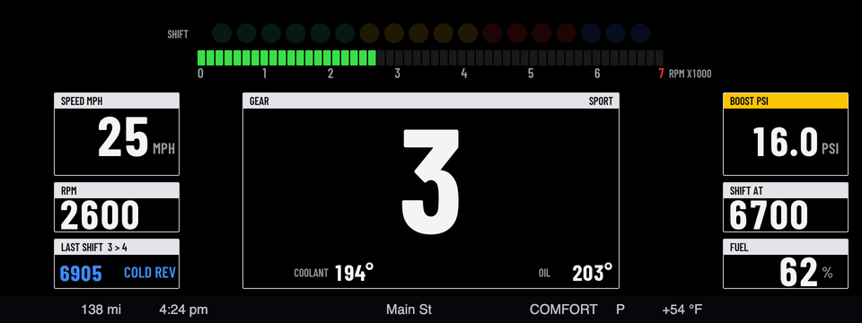
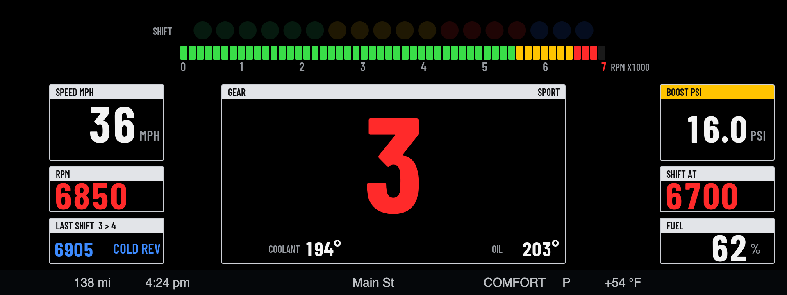
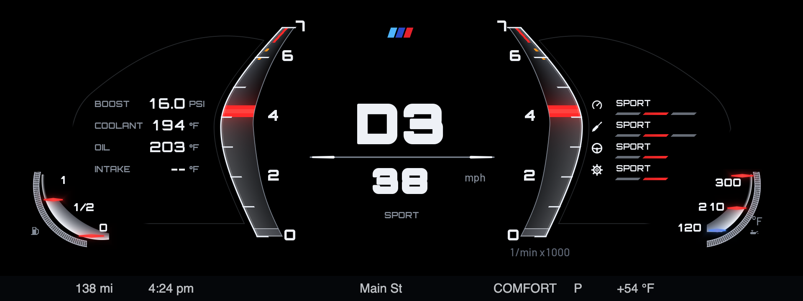
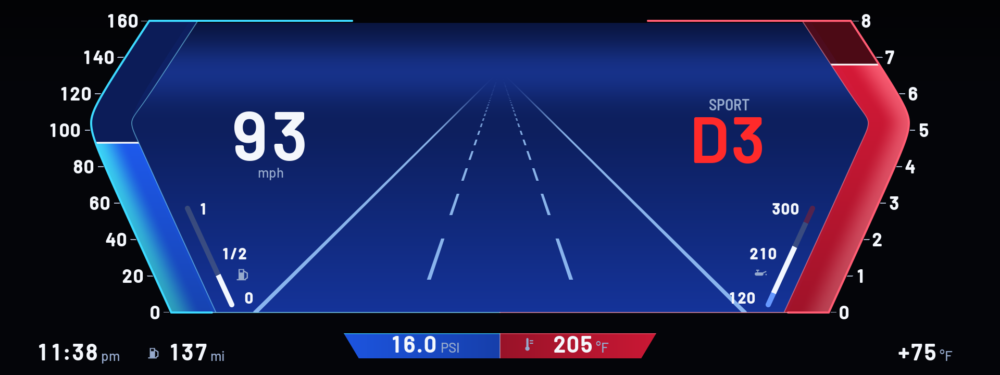
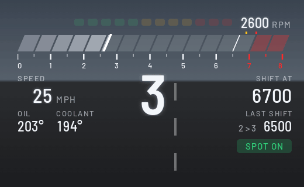
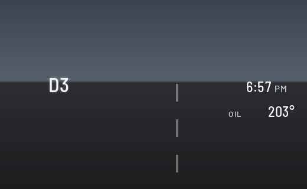
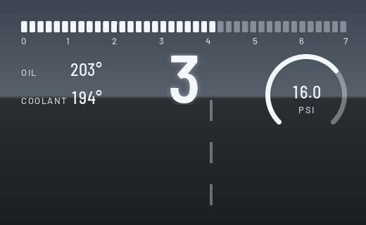
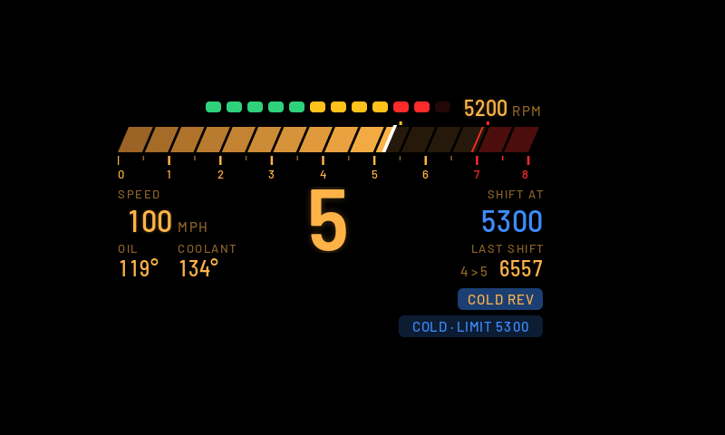

# bimmer-lab apps

Apps for BMW iDrive 7 head units (MGU), installed through the community MGU Store.

## Apps

### Cluster Themes

Redraws the whole instrument cluster with your own themes, picked on the center screen. Three themes so far: a GT3 race dash (shift lights, a rev bar, boost, temperatures, and a grade on every upshift), an M-style cluster (glass rev blades, a G-meter, and the drive setup), and a Sport view (blue speed and red rev brackets round a lane view or the map). [More](apps/cluster_themes/README.md)

### HUD Widgets

Your own widgets on the windshield HUD. There are three layouts: Daily, Sport, and Redline (a rev bar with shift lights and shift scoring). Each comes in Classic, M and Night themes, plus Auto, which switches to Night at sunset. [More](apps/idrive_hud_widgets/README.md)

| Daily | Sport | Redline |
| --- | --- | --- |
|  |  |  |

## Install

1. Install **cluster-render** first. Both apps draw through it. It comes from the `robertnisipeanu/idrive-apps` Store source.
2. In the Store, go to **Settings → Add source**, enter **`bimmer-lab/apps`**, then install the apps you want.
3. Open the app from the apps menu on the center screen to pick a layout or theme.

The Store builds each app on the car from this repo. No BMW code is in it.

## Status

Both apps ran in a first car test on a 2020 X3 M40i, and this version fixes what it found. Each app has an Off option and can switch with the SPORT / COMFORT / ECO PRO buttons, so the cluster theme and the HUD take turns. Each app's page lists what's still to be checked on the car.

## Credits

- [cauliflowermossgrape/idrive7-apps](https://github.com/cauliflowermossgrape/idrive7-apps): the MGU App Kit (MIT) these apps are built on, and the Redline app the shift scoring comes from.
- [robertnisipeanu/idrive-apps](https://github.com/robertnisipeanu/idrive-apps): cluster-render, which draws on the HUD and the cluster.
- Barlow and Michroma typefaces (SIL Open Font License).

## Licence

MIT. Third-party parts are listed in each app's `NOTICE`. To work on the apps, see [docs/DEVELOPING.md](docs/DEVELOPING.md).
