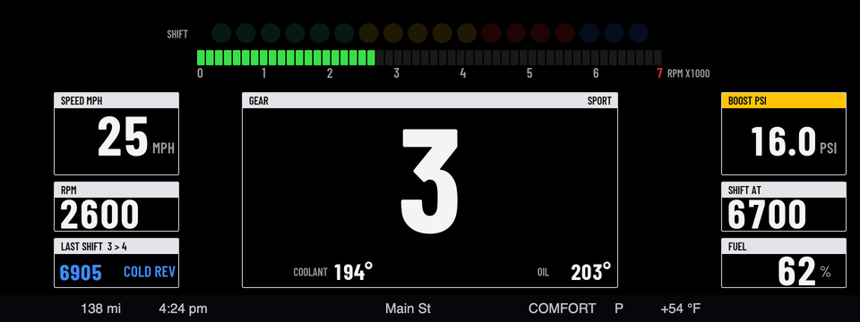
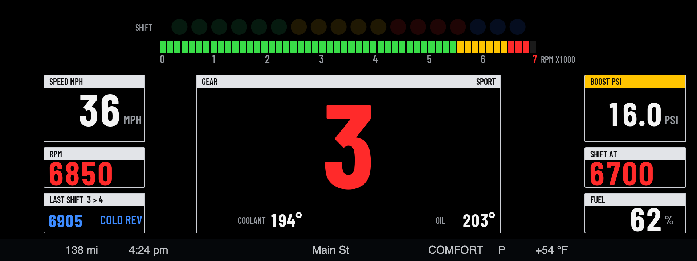
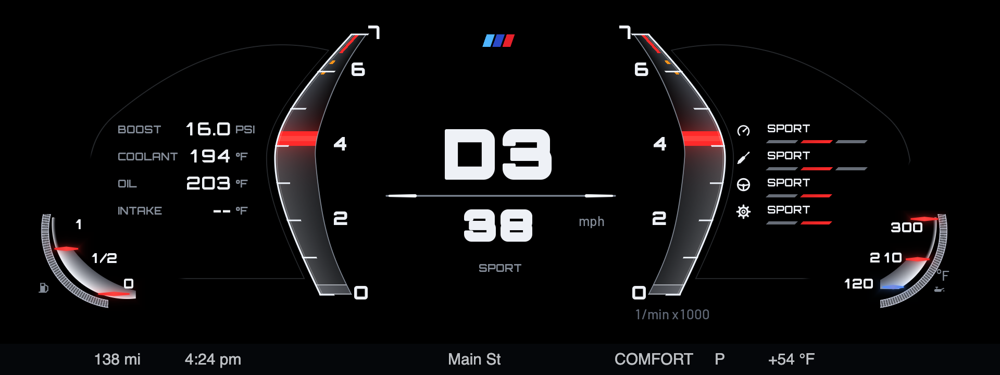
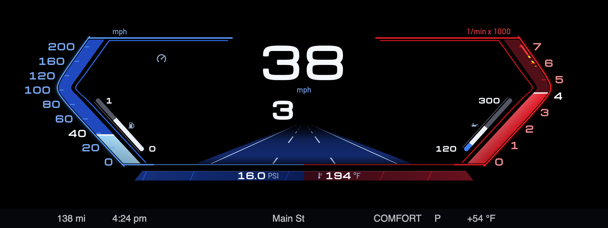
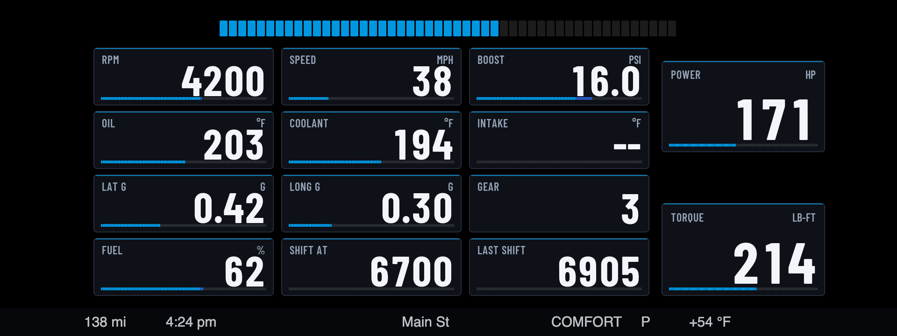
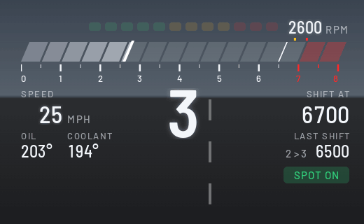
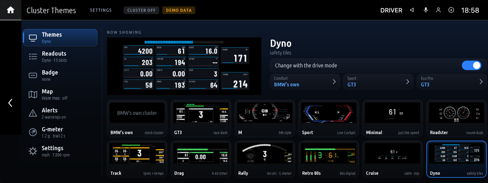
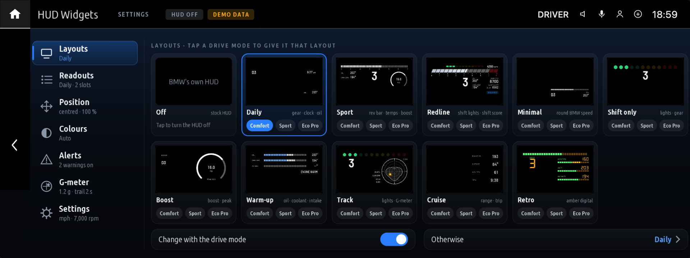

# bimmer-lab 应用

[English](README.md)

适用于 BMW iDrive 7（MGU）的应用，可通过社区 MGU Store 安装。



## 仪表主题（Cluster Themes）

在中控应用菜单中打开「仪表主题」，可以重绘整个仪表画面。内置 GT3 赛车仪表、M 风格、运动、极简、跑车圆表、赛道、直线加速、拉力、复古 80 年代、巡航和马力机主题。可以手动选主题，也可以为运动、舒适和节能模式分别设置主题。详见[上游应用说明](apps/cluster_themes/README.md)。






## 抬头显示小组件（HUD Widgets）

可在挡风玻璃的抬头显示上查看挡位、换挡灯、增压压力、机油温度、冷却液温度、进气温度、G 值和行程数据。提供十种布局，可选经典、M 和夜间配色，巡航和复古布局自带配色。详见[上游应用说明](apps/idrive_hud_widgets/README.md)。本次简体中文改动面向仪表主题的中控界面和原生设置。



## 设置和安装

1. 在 MGU Store 中，从 `robertnisipeanu/idrive-apps` 安装 **cluster-render**。从 0.5.1 版起，仪表主题和 HUD 布局可以同时显示。
2. 安装上游英文版时，在 Store 的「设置 → 添加来源」中输入 `bimmer-lab/apps`，选择所需的应用。
3. 从中控应用菜单打开应用，选择主题或布局。可分别配置驾驶模式、读数、单位和时区。
4. 主机时钟使用 UTC。可在「设置 → 时区（时钟）」选择固定偏移或地区时区，地区时区会自动处理夏令时。在中国大陆可选 `UTC+08:00`。

上游 Store 来源会在车机上构建软件，两款应用在上游的一辆 2020 X3 M40i 上测试过。各应用说明列有上游实车验证范围，版本历史见 [CHANGELOG.md](CHANGELOG.md)。

### 构建简体中文版

准备本机的 BMW OAP SDK，沿用[上游开发说明](docs/DEVELOPING.md)配置环境。中文构建使用同一个应用 ID，有独立的版本后缀。

```sh
python kit/tools/build.py --language zh-CN cluster_themes
```

在 `dist/` 查看生成的 `.mgu` 和 `.tgz`。中控主题、读数配置、Waze 状态、车型标识、警告、G 值和设置页使用中文资源。仪表本身采用主题的专用字体，随主题绘制的文字仍为上游样式。此中文构建尚未在车机验证。




## 使用说明

这是爱好者开发的非官方应用。安装第三方应用可能影响保修。应用只读取车辆数据。主题和布局绘制在宝马原厂显示上方，读数仅供参考，应留意原厂警告。遇到显示异常时，在主题选择中切回「关闭（宝马原厂仪表）」。请停车后再进行设置。软件按 MIT 许可原样提供。

## 原项目和署名

- 原项目为 [bimmer-lab/apps](https://github.com/bimmer-lab/apps)。原作者版权见 [LICENSE](LICENSE)，第三方声明见各应用目录的 `NOTICE`。
- MGU App Kit 和换挡评分来自 [cauliflowermossgrape/idrive7-apps](https://github.com/cauliflowermossgrape/idrive7-apps)，Redline HUD 由 [@biscotit](https://github.com/biscotit) 开发。
- 仪表和 HUD 使用 [robertnisipeanu/idrive-apps](https://github.com/robertnisipeanu/idrive-apps) 的 cluster-render。
- Barlow、Michroma、Orbitron 和 Noto Sans SC 使用 SIL Open Font License。
- 简体中文汉化：抖音「小白科技杂物社」 · BiliBili「小白151」 · GitHub [JackieZ123430](https://github.com/JackieZ123430)。
