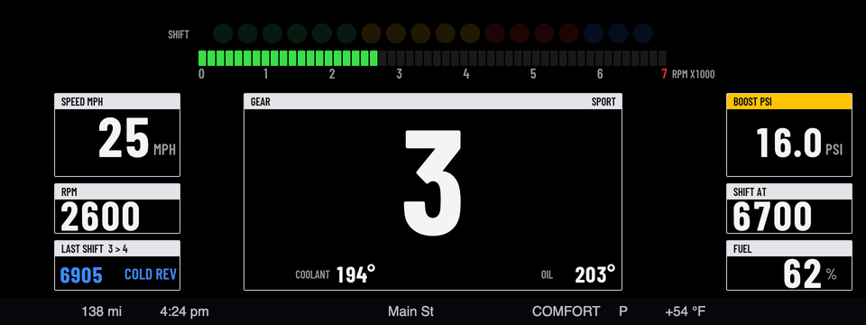
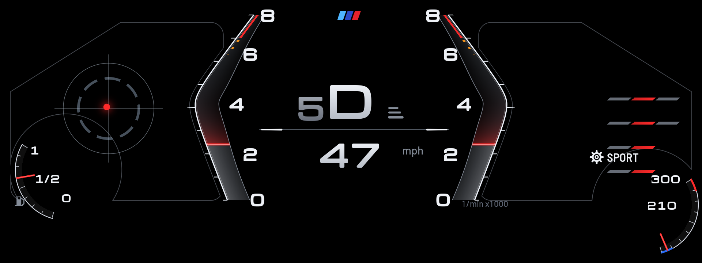
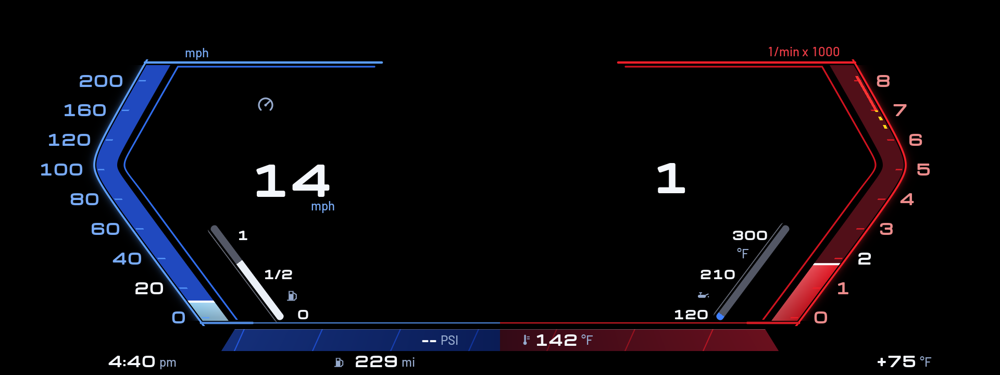
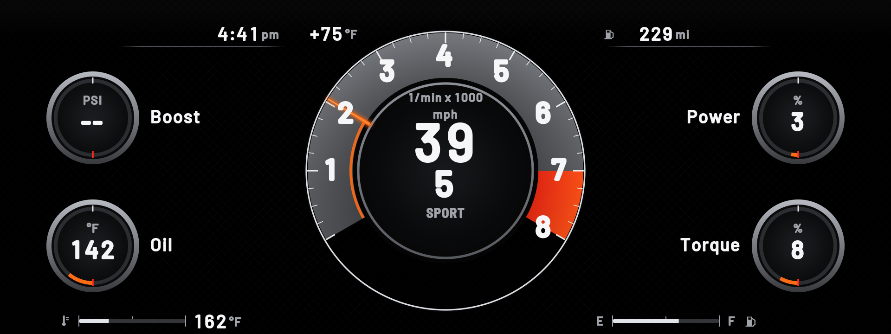
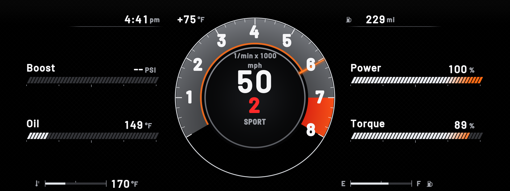
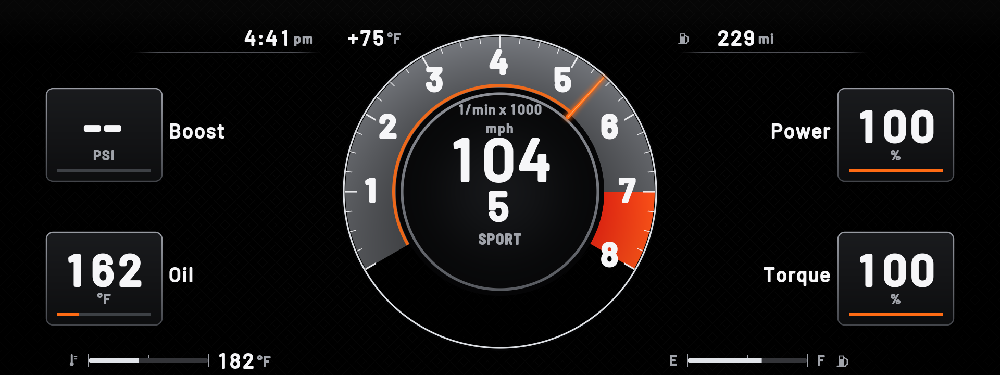
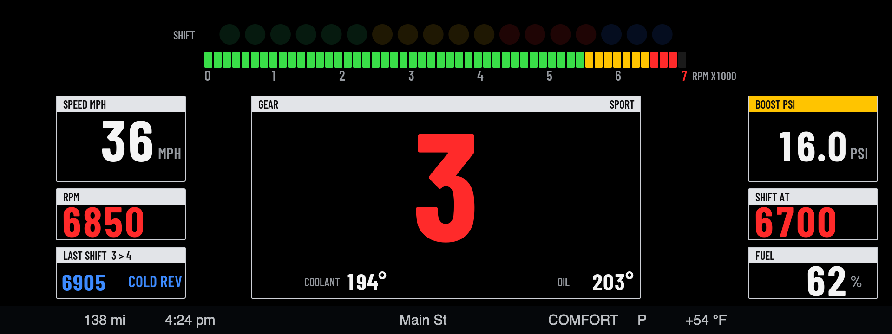
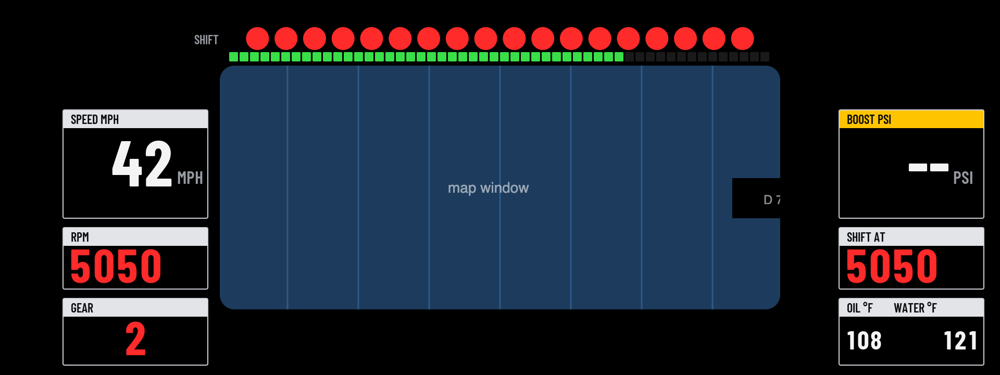

# Cluster Themes

Redraws the whole instrument cluster with your own themes. Open **Cluster Themes** from the apps menu on the center screen and pick the theme there.

## Themes

**GT3:** a race dash.

- **Top:** 18 round shift lights (green, yellow, red, then blue) that fill over the last 2000 rpm before your shift point, and a segmented rev bar.
- **Left:** speed, rpm, and your last shift with its grade.
- **Middle:** the gear, with water and oil temperatures.
- **Right:** boost, your shift point, and the clock.
- **At the shift point,** the lights, the rev bar, the rpm and the gear all go red.

**M:** the look of a current M8's cluster, on black.

- **Middle:** two glass rev blades either side of the gear and speed, with a red needle line, orange and red marks before your redline, and the gear in chrome.
- **Left:** a G-meter (the red dot moves with your cornering, braking and acceleration) and a fuel gauge, on a card drawn as an outline.
- **Right:** what the engine, chassis, steering and gearbox are set to (the segment at the level lights red, as on the M8), and an oil temperature gauge. The rows change with the drive mode buttons: Comfort, Sport, Sport Plus (engine and gearbox go SPORT PLUS) and Eco Pro (engine and gearbox go EFFICIENT). The car only reports the overall mode, not each part, so an Individual setup shows as its base mode.
- **Bottom:** range, the clock, and the outside temperature.
- "Leave room for the map" works in GT3 and Sport, not in M yet.

**Sport:** the look of BMW's newer Live Cockpit Sport view.

- **Left:** speed as a blue bracket on BMW's 0 to 200 mph scale (0 to 320 km/h), with the digital speed and a fuel bar inside it. The scale number nearest your speed lights up.
- **Right:** revs as a red bracket with yellow and red marks before and past your redline, with the gear and an oil temperature bar inside it.
- **Middle:** black. With "Leave room for the map" on, BMW's map shows there, framed by the brackets.
- **Bottom:** boost and coolant in the blue and red strip, plus the clock, range and outside temperature.

**Dials:** a big round tach in the middle with gauges either side.

- **Middle:** a round tach with a grey band, a red zone from your redline, and an orange needle that turns red at the shift point. The speed, gear and drive mode sit inside it.
- **Sides:** boost and oil stacked on the left, power and torque (as % of the engine's peak) stacked on the right.
- **Gauge style:** pick round dials, bars, or big digital numbers for the four side gauges.
- **Top:** the clock, outside temperature and range, either side of the tach. **Bottom:** coolant and fuel bars (the fuel bar turns orange when low).
- "Leave room for the map" doesn't apply to this theme.

| Bars | Digital, at the shift point |
| --- | --- |
|  |  |

More themes are on the way.

| At the shift point | With room for the map |
| --- | --- |
|  |  |

## Off and drive modes

- **Off (BMW's own cluster):** pick it as the theme and the app draws nothing, so BMW's cluster comes back.
- **Change with SPORT / COMFORT / ECO PRO** (on by default): the cluster follows the drive mode buttons. Pick a theme for each mode. Out of the box, Sport shows GT3, and Comfort and Eco Pro show BMW's own cluster. Until the car reports a mode, the plain theme setting is used.
- **Works with HUD Widgets:** the cluster theme and the HUD can't show at the same time (cluster-render shares one screen slot between them). With the defaults, Sport gets the cluster theme and Comfort gets the HUD, so they take turns.

## Settings

- **Theme**, and one per drive mode
- **Leave room for the map:** cuts a window out of the dash so the map can show through (a rounded window, inset a few pixels so the stock cluster's corners don't peek out; `holeInset` and `holeRadius` in the layout), moves the gear and temperatures to the sides, and slims the rev bar.
- **Gauge style (Dials theme):** round dials, bars or digital
- **Calibration grid:** a theme that draws lines every 50 px with x/y labels, for checking where things sit on the real screen.
- **Units:** mph, °F, psi or km/h, °C, bar
- **Clock:** 12-hour or 24-hour
- **Redline**
- **Shift point before redline:** how far below the redline the shift lights peak (300 rpm by default)
- **Cold-engine rev guard:** until the oil reaches 80°C, the shift point starts at 4500 rpm and climbs as the oil warms up
- **Show boost**
- **Demo data:** fake data for trying it out parked

**Shift grades:** every upshift is graded on its peak rpm. EARLY means more than 250 rpm under the shift point, LATE more than 200 over it, COLD REV the same while the cold guard is on, LIMITER within 60 rpm of the redline, and anything in between is SPOT ON.

## Requirements

[cluster-render](https://github.com/robertnisipeanu/idrive-apps), installed from the `robertnisipeanu/idrive-apps` Store source.

## Status

Version 0.5.1 (0.5.0 added the Dials theme; 0.5.1 matches the M and Sport themes to BMW's own clusters). First car test done on 0.1.0 (Nov 2026): the shapes drew upside down (fixed), only part of the dash drew (the status row now says what's missing and why), and the map cut-out was in the wrong place (moved to where the map sits on an X3). Second car test (Nov 5 2026): the car drew only the first few layers (every theme now uses at most 3 effect layers: the GT3 frame is one layer, the M setup bars are part of the backdrop), dark tints came out light (every backdrop is now pure black, pending a measured curve), and the hood and BMW's own black gear box hid the top corners and x 1406..1597, y 342..419 (everything moved clear of both). Still to be checked on a car:

- **Whether the whole dash draws.** If it doesn't, the first row of the app's page says how many parts are drawn and why the rest aren't.
- **Whether BMW's warning lights still show over the dash.** The GT3 theme is solid black and covers whatever is under it. Test it parked: start the car with a seat belt off and look for the warning.
- The drive mode switching, and the map cut-out's new position.
- Whether Power % and Torque % in the Dials theme read sensibly. They come from the car's crankshaft torque signal and count from 500 Nm and 285 kW, an M40i's peak.
- How the colours and edges look on the real screen.
