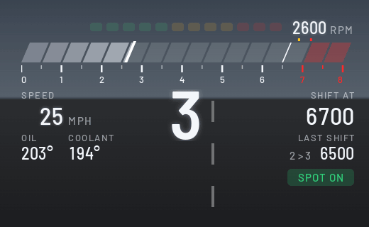
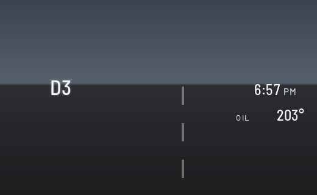
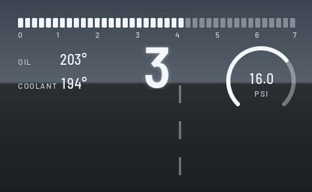
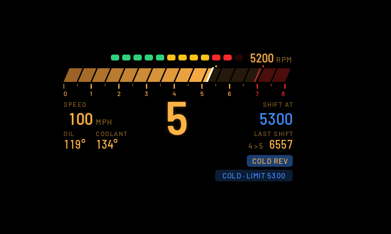

# HUD Widgets

Your own widgets on the windshield HUD: speed, gear, a shift bar, boost, oil and coolant temperatures, and a clock. Open **HUD Widgets** from the apps menu on the center screen and pick the layout, theme, units and widgets there.

## Layouts

| Daily | Sport | Redline |
| --- | --- | --- |
|  |  |  |

- **Daily:** speed is the hero, with the gear, clock and oil.
- **Sport:** a segmented shift bar, a big gear, speed, a boost gauge, oil and coolant.
- **Redline:** a slanted G20-style rev bar with 12 shift lights, a big gear, and your shift point.
  - **Shift lights:** they come on from 3000 rpm and fill up to the shift point. At the shift point, everything goes red and SHIFT shows.
  - **Shift grades:** every upshift is graded on its peak rpm. EARLY means more than 250 under the shift point, LATE more than 200 over it, COLD REV the same while the cold guard is on, LIMITER within 60 rpm of the redline, and anything in between is SPOT ON.
  - **Cold-engine guard:** until the oil reaches 80°C, the shift point starts at 4500 rpm and climbs as the oil warms up.

## Themes

Classic, M and Night, plus Auto, which switches to Night at sunset. You choose which theme Auto uses in daytime.

## What the driver sees (the visible window)

The HUD is an 800x480 target, drawn 1:1, but only part of it comes through the windshield. From the calibration grid photo of Nov 5 2026 (`design/photos/hud-grid-2026-11-05.png`, warped onto target pixels in `hud-grid-warp-800x480.png`), the visible window is **x 120, y 100, 485 x 278** from the driver's eye; it moves a little with eye position and HUD height.

BMW keeps drawing its own HUD content over ours. In Comfort mode that is the speed readout and the speed-limit sign in the bottom-left of the window: measured on the same photo, the sign sits at x 160..202, y 322..378 and "0 mph" at x 275..343, y 331..376 (target px). The layouts keep the bottom-left **x 150..355, y 314..378** free for it (the measured content plus slack for a three-digit speed). In Sport mode BMW moves its speed to the middle and adds its own rev line, which is why Sport hands the HUD back to BMW by default (below).

All three layouts were refitted to the window on Nov 5 2026: everything sits inside it with a 6 px margin, the fonts came down (hero 140 to 96 px, big 42 to 34, mid 30 to 24; the label and small sizes stayed, they are the size of BMW's own "mph"), the bars are 465 px long, and the Redline layout moved its rpm readout to the top-right, its SHIFT prompt beside the gear and its grades to the right column. The window rect and BMW's region are in each layout's `_about` note.

## Off and drive modes

- **Off (BMW's own HUD):** pick it as the layout and the app draws nothing, so BMW's HUD comes back.
- **Change with SPORT / COMFORT / ECO PRO** (on by default): the HUD follows the drive mode buttons. Pick a layout for each mode. Out of the box, Comfort shows Daily, and Sport and Eco Pro hand the HUD back to BMW: in Sport, BMW's own HUD puts its speed and rev line in the middle of the window, right where our layouts live, so they would draw on top of each other. Until the car reports a mode, the plain layout setting is used.
- **Works with Cluster Themes:** the HUD and the cluster theme can't show at the same time (cluster-render shares one screen slot between them). With the defaults, Comfort gets the HUD and Sport gets the cluster theme, so they take turns.

## Calibration grid

Pick **Calibration grid** as the layout to see lines every 50 px with x/y labels on the real glass. It also carries a probe row L1..L16: L1..L3 are on the app's own connection to cluster-render (its 8 layers, with the grid, labels, swatches and the atlas text), L4..L8, L9..L12 and L13..L16 on three more. A photo with all sixteen means each connection gets its own 8 layers. Above the swatches, "ATLAS", the clock and the rpm are drawn by one shader layer reading a glyph atlas uploaded once as a one-byte-per-pixel asset (0.5.3): if that line shows, text can be drawn with no pixel writes at all. A photo of it shows exactly which part of the HUD is visible, so layouts can be fitted to it. That is how the window above was measured; take a new photo if the HUD height or the seat changes a lot.

## Settings

Layout, drive mode switching, theme, daytime theme for Auto, units (mph, °F, psi or km/h, °C, bar), 12- or 24-hour clock, redline, shift point before redline, cold-engine rev guard, which readouts show (clock, oil, coolant, boost), and demo data. Changes show on the HUD right away. The HUD keeps running after you leave the page.

The page's first row tells you what the HUD is doing, the drive mode it sees, and why anything isn't drawn (for example "waiting: another app has this display").

**Boost:** read from the car's sport display signal. When the car doesn't send it, the app asks the engine computer directly (read only), the same way Car Vitals does.

## Requirements

[cluster-render](https://github.com/robertnisipeanu/idrive-apps), installed from the `robertnisipeanu/idrive-apps` Store source. Without it, the status row reads "HUD off: cluster-render is not installed or not running".

## Status

Version 0.5.3 (0.5.3: the calibration grid carries an atlas-text probe, text drawn by a shader from a glyph atlas asset, no pixel writes per value; 0.5.2: the engine can draw over several connections to cluster-render, 8 layers each, which the calibration grid's L5..L16 probe on the glass; pixel memory is counted; text sends only the pixels that changed; 0.5.1: the shift lights come on from 3000 rpm; 0.5.0 refit every layout into the visible window). First car test done on 0.3.1 (Nov 2026): it runs, rpm wobbled at idle (now smoothed), boost didn't show (now read from the engine computer as a backup), and the top and sides of the Redline layout fell outside the visible part of the HUD. The calibration grid was photographed on Nov 5 2026 and all three layouts were refitted to the visible window on the bench (deployed to the repo, not yet seen on the car). Still to be checked on a car:

- the refitted layouts on the glass: that nothing is cut off and nothing sits under BMW's speed and sign;
- the drive mode switching and the engine computer boost;
- how the colours and edges look on the real glass, especially the M blues in sunlight;
- whether the head unit's clock is in local time.
